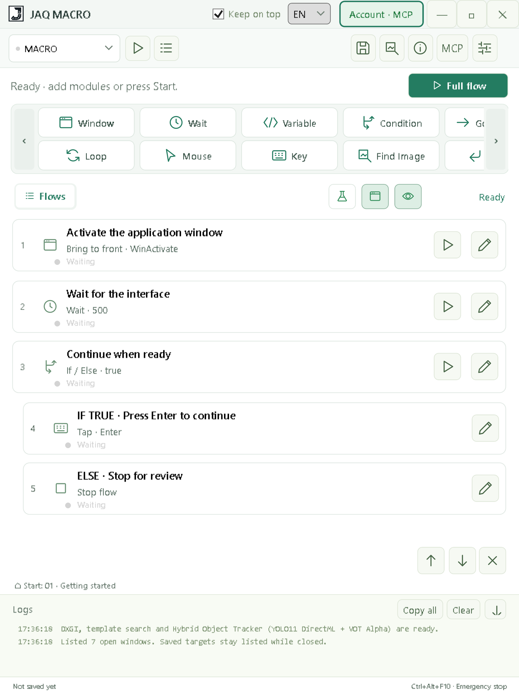
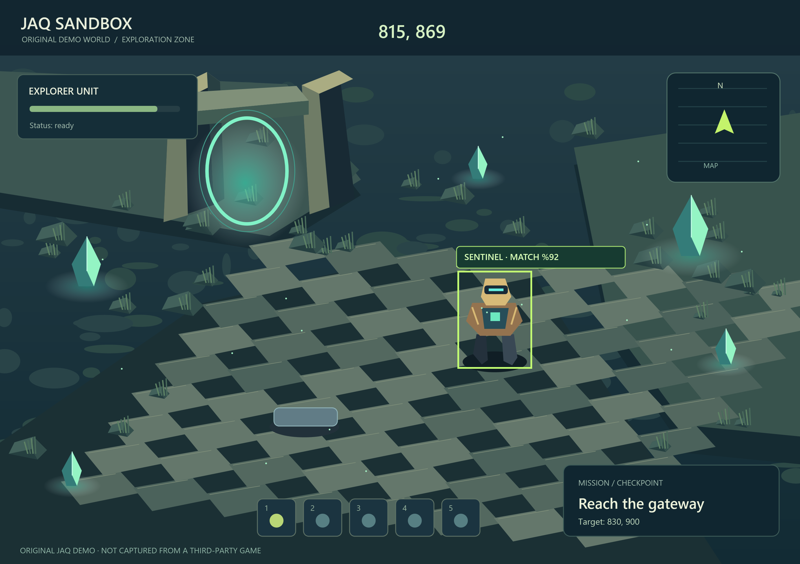
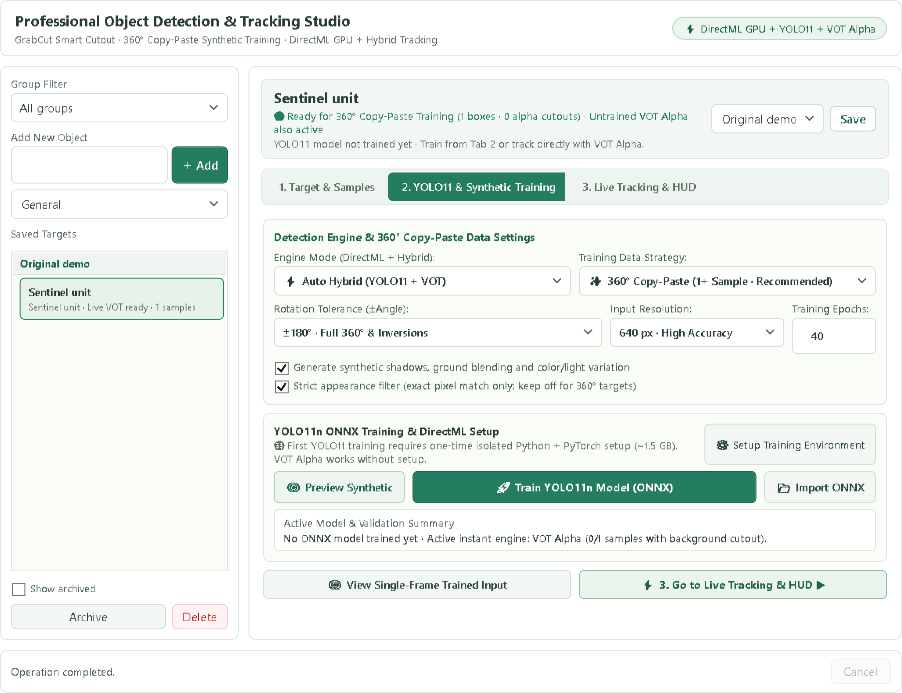

# JAQ Macro

### Visual automation. State-aware workflows. AI-assisted design.

JAQ Macro brings visual workflow editing, object tracking, coordinate feedback, OCR and MCP-connected assistants into one Windows automation workspace.

**This repository is the public product and release hub. The application is proprietary, and its source code is not published here.**

> **Current release: documentation-only distribution test.** The attached ZIP contains Markdown documents only. It does not contain an executable, installer, application source code or license keys. A runnable application download is not being offered yet.

[Latest releases](https://github.com/fatihyilmas/JAQ-Macro/releases) · [Feature guide](docs/FEATURES.md) · [Workflow examples](docs/EXAMPLES.md) · [Update and download guide](docs/UPDATES.md)

## Beyond replaying the same clicks

A button can move. A window can load slowly. A target can disappear. JAQ Macro is designed to connect **observation → decision → action → verification**, rather than assume every replay encounters the same scene.

- **15 visual modules:** Window, Wait, Variable, Condition, Loop, Go to group, Call group, Return, Stop, Mouse, Keyboard, Find image, Program/files, Read text and Coordinate navigation.
- **Object recognition and tracking:** exemplar-based VOT Alpha, trained YOLO11 ONNX and automatic hybrid options; DirectML GPU/CPU inference where supported.
- **A visual training workspace:** annotation, GrabCut background separation, Alpha masks, 360° Copy-Paste synthetic-data preparation and configurable appearance filtering.
- **Coordinate feedback:** local OCR, configurable axes, motion/arrow heading sources, waypoints, tolerance and optional pre-movement/verified-arrival actions.
- **Route recording:** keyboard/mouse events, scan-code options, checkpoints, playback timing and optional coordinate verification.
- **Structured logic:** true/false branches, nested conditions, bounded loops, variables, 32 built-in functions and reusable helper groups.
- **MCP-assisted design:** compatible assistants can inspect workflow metadata, understand real module settings and continue from task checkpoints.
- **Observable execution:** dry run, individual/group tests, logs, limits, result variables and emergency-stop shortcuts.

## Object tracking at the center

Prepare a target example, separate unnecessary background, choose an engine and inspect the actual result before adding an action. An overlay can show location and detected bounds; a workflow decides what to do with that observation.

*The illustrated world was created specifically for JAQ and contains no third-party game assets. The image shows a local detector result in that controlled demo, not a commercial-game performance or compatibility benchmark.*

## Design with your assistant

Use an MCP-capable client such as **Codex, Antigravity, Kiro, Claude Code, Cursor or another compatible tool**, subject to its current transport and authentication support. The central guide, module contract and design-task checkpoints help the assistant work with the actual project rather than invent unsupported steps.

Example request:

> Inspect my open project and its timestamp. Preserve existing resources. Separate preparation, main actions and recovery. Use reusable groups for repeated checks, bounded loops for repetition and conditions for missing targets. Ask only for local image selections that are actually necessary, then validate the design.

Client names do not imply formal partnerships. MCP exposes workflow tools; local execution remains a separate, user-controlled step. Image files are not uploaded/downloaded through MCP.

## Compare approaches, not marketing claims

| Need | Input recording alone | JAQ Macro approach |
|---|---|---|
| A target moves | Revisit recorded positions | Locate with image/object observations |
| The interface loads at variable speed | Guess a fixed delay | Wait for an observed state |
| Work depends on visible text | Additional recognition is needed | Local OCR and optional AI OCR |
| An action should depend on a result | A fixed sequence does not decide | Conditions, typed variables and formulas |
| A long project repeats common tasks | Maintain repeated sequences | Groups, calls, returns and shared checks |
| A destination must be verified | Input duration alone cannot verify arrival | Coordinate OCR and movement feedback |
| AI should edit the actual project | Recording alone does not expose a contract | MCP metadata tools, central guidance and task tracking |

This compares methods, not named competing products. It does not claim every other tool lacks these capabilities.

## Desktop tasks and game workflows

Build from the actual starting state: an application may already be open at the relevant screen. Connect window checks, image/OCR observations and input without adding unnecessary launch steps. Recheck the result after acting.

Input and capture behavior vary by application. Background window messages have limitations; Raw Input/DirectInput compatibility is not universal. Coordinate navigation is not a universal obstacle/pathfinding engine. Use software only where permitted and test the target environment.

## Downloads and updates

Release ZIPs are published under [Releases](https://github.com/fatihyilmas/JAQ-Macro/releases), not as application source. The current preview tests the distribution channel with harmless documents only.

The application update design verifies a signed descriptor, archive size/hash and declared file contents. Downloading does not authorize installation: extraction/replacement requires a separate confirmation. Application updates wait for an idle, saved workspace; documentation tests extract into a separate `Update-Test` directory and never replace the application.

## Licensing and security

JAQ Macro is proprietary. Public availability of this repository does not grant access to application source or permission to redistribute internal builds. Read [LICENSE.md](LICENSE.md). MCP access and Pro file-transfer entitlements are separate; AI provider usage may have separate costs.

Do not post passwords, license keys, MCP tokens, API credentials or private workflow backups in public issues. See [SECURITY.md](SECURITY.md).
