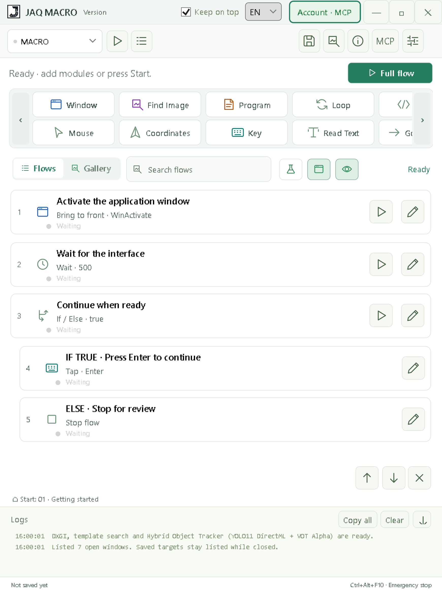
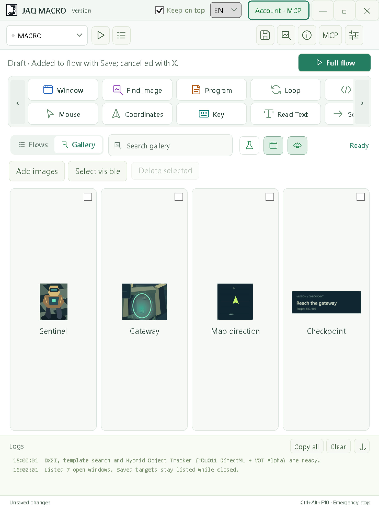
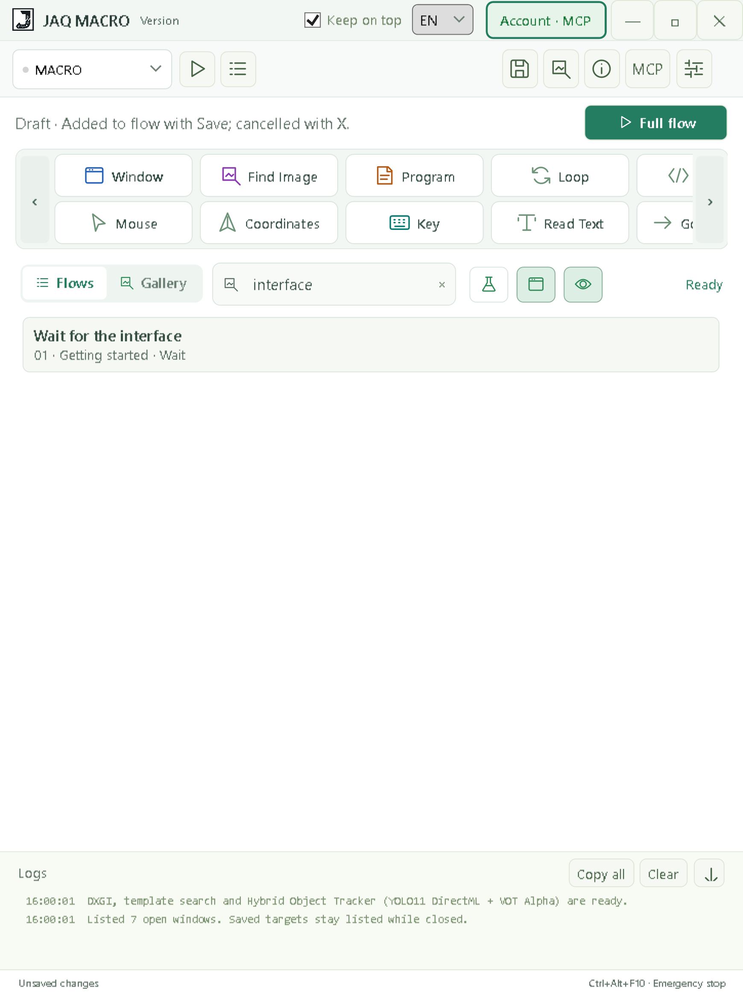
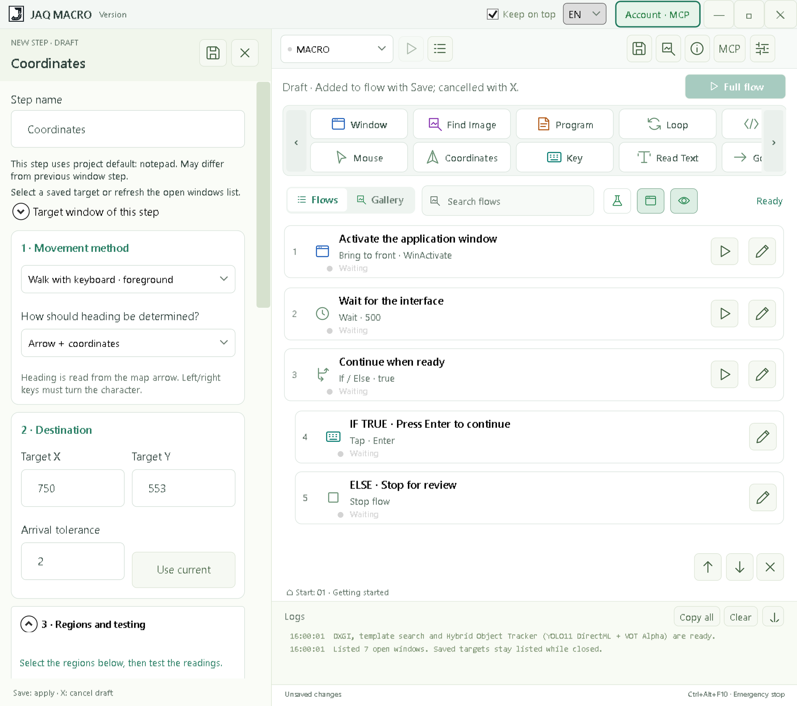

# JAQ Macro

JAQ Macro is a visual automation studio for Windows. Build workflows that find images and objects, read on-screen text and decide what to do based on the result. Connect an MCP-compatible AI assistant when you want help planning or editing a workflow.

**Latest release · 2.0.27 for Windows x64**

[Download the ZIP](https://github.com/fatihyilmas/JAQ-Macro/releases/download/v2.0.27/JAQ-MACRO-2.0.27-win-x64.zip) · [Release notes and checksums](https://github.com/fatihyilmas/JAQ-Macro/releases/tag/v2.0.27)

## What's new in 2.0.27

- **Image Gallery.** Browse project images in a four-column grid, open larger previews, import batches and delete unused images. Pick a saved image directly from the Find image module.
- **Workflow search.** Use the search box to find steps by name, module or setting. The same box filters images when the Gallery is open.
- **Coordinate navigation.** Guide movement using changes in the observed coordinates or a tracked direction arrow. Configure waypoints, movement keys, calibration and arrival checks.
- **Run controls.** Run the full workflow or an individual group. The draggable panel shows run status and stop shortcuts over the target window. Minimize the studio to the Windows notification area for quick access.

| Image Gallery | Workflow search |
| --- | --- |
|  |  |

## Build workflows around what appears on screen

| What you need | What JAQ Macro can do |
| --- | --- |
| Find a target that moves | Search a window or region for image templates, trained objects, pixel colors or color coverage. |
| Read visible information | Use Windows or Paddle OCR locally, or configure optional AI OCR. Use the result in later steps. |
| Act on the result | Combine window checks, mouse and keyboard actions, typed variables, conditions and bounded loops. Organize repeated actions into callable groups. |
| Verify movement | Read position with OCR, guide movement using coordinate feedback, or play back a recorded route with checkpoints. |
| Troubleshoot a flow | Use dry runs, run a group independently, inspect logs and result variables, and stop with a keyboard shortcut. |

The object library supports exemplar-based tracking and YOLO11 ONNX models. Annotation tools, background separation and masks help prepare examples. Test a match and inspect its location and bounds before adding an action.

| Object detection in the original JAQ demo | Coordinate navigation inspector |
| --- | --- |
|  |  |

Capture and input support depend on the target application. Test workflows in the environment where they will run.

[Full feature guide](docs/FEATURES.md) · [Workflow examples](docs/EXAMPLES.md)

## Design a workflow with an AI assistant

Open the MCP connection area in JAQ Macro and copy the quick-start instructions into a compatible client such as Codex, Claude Code, Kiro or Antigravity. With a compatible connection and account access, the assistant can inspect the current project, look up module settings, edit the workflow and resume a design task from a checkpoint. Image assets stay on your computer. Run and verify the workflow in JAQ Macro.

A good first request describes the starting state, the desired result and how to verify it.

> The application is already open. Add a window check, wait until the Start button is visible, click it once and verify that the next screen appears. If a reference image is missing, tell me which area to capture in JAQ Macro. Use a bounded retry and show me how to test the group.

## Get started

1. Download **JAQ-MACRO-2.0.27-win-x64.zip** from Releases.
2. Extract the complete ZIP into a writable folder and keep the `lang` folder alongside `JAQ-MACRO.exe`.
3. Open `JAQ-MACRO.exe` and approve the Windows administrator request. The interface is available in English and Turkish.
4. Add a target window, build a short flow and test the group before running the full project.

This repository is the public download and documentation hub for proprietary JAQ Macro software. GitHub's generated source archives contain the public documentation and images.

[Downloads and updates](docs/UPDATES.md) · [License](LICENSE.md) · [Security](SECURITY.md)
